# Admin user guide

Use this guide to keep the website up to date: edit pages, manage pictures and menus, change settings and publish. Every task has numbered steps and a picture of the screen. Click a picture to open it full size. Open **Help** at the bottom of the sidebar to come back here.

The pictures show the paul-carrick.com site. Your own site shows your own pages and pictures in the same places.

## Table of contents

- [Getting started](#getting-started)
- [Publishing changes](#publishing-changes)
- [Using list pages](#using-list-pages)
- [Pages, sections, and columns](#pages-sections-and-columns)
- [Pages](#pages)
- [Editing from the page itself](#editing-from-the-page-itself)
- [Sections](#sections)
- [Columns](#columns)
- [Writing and formatting content](#writing-and-formatting-content)
- [Image files and groups](#image-files-and-groups)
- [Blogs](#blogs)
- [Menus](#menus)
- [Users and access](#users-and-access)
- [Site setups](#site-setups)
- [History and restoring an earlier version](#history-and-restoring-an-earlier-version)
- [Keyboard shortcuts](#keyboard-shortcuts)
- [Common questions](#common-questions)

## Getting started

Sign in with an account that has administrator access, then open the admin: choose the gear icon in the site's header (it opens in a new tab), or go to `/admin`.

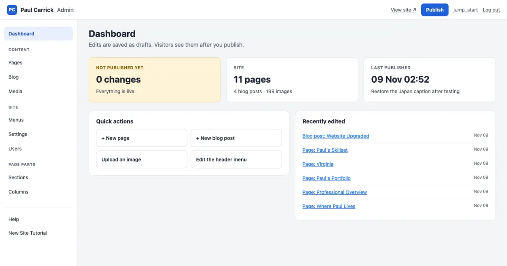

The admin has three parts:

- The **top bar** shows the site's name, **View site** (opens the public site in a new tab), **Publish** with the number of changes waiting, your name and **Log out**.
- The **sidebar** is grouped: **Dashboard**; **Content** (Pages, Blog, Media); **Site** (Menus, Settings, Users); **Page parts** (Sections, Columns); and **Help**, **Video Tutorial** (a narrated video, about four minutes, of building a website from an empty site; it opens in a new tab) and **New Site Tutorial** at the bottom. On a phone, the ☰ button opens it.
- The **Dashboard** shows how many changes are not published yet, the site's counts, when it was last published, **Quick actions** (New page, New blog post, Upload an image, Edit the header menu) and the pages and posts edited most recently. Click one of them to open it.

### A typical change, start to finish

1. Choose **Pages** in the sidebar and click the page's title. The page opens in its workspace.
2. Click the section in the preview, or the column's name in the outline.
3. Change the text in the panel on the right and choose **Save Column**. The change is saved as a draft; visitors do not see it yet.
4. Choose **Publish** in the top bar, check the change, and choose **Publish**. Now visitors see it.

### Things that work the same everywhere

- **Enabled** decides whether something shows on the public site. Switch it off and save to hide a page, section, column, picture, menu item or post without deleting it. It stays in the admin, where you can switch it on again. Hiding a page hides everything on it; hiding a section hides its columns.
- Fields marked with an **asterisk (\*)** must be filled in.
- A **Save** button stays greyed out until the form is ready to save (for example, a new section needs its columns generated first).
- **Cancel** leaves a form without saving what you typed. It does not undo something you already saved.
- **History** (top right of most edit screens) lists the earlier versions of what you are editing. See [History and restoring an earlier version](#history-and-restoring-an-earlier-version).

## Publishing changes

Everything you save in the admin is a **draft**. Visitors keep seeing the live site until you publish. New things and deletions are drafts too. Lists show each item's status: **Live**, **Draft changes**, **New** or **Hidden**.

The number on the **Publish** button in the top bar is how many changes are waiting.

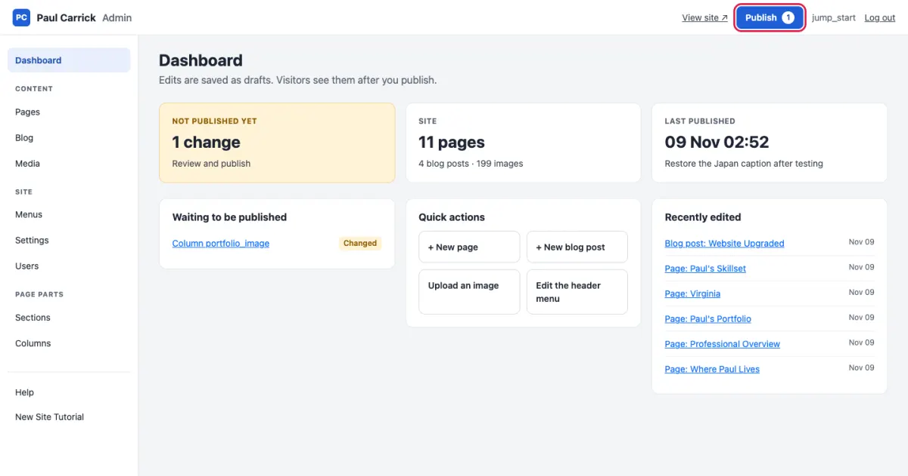

### How to publish your changes

1. Choose **Publish** in the top bar. **Review and publish** opens.
2. Read the list. Changes are **grouped by page**: a page's settings, its sections and columns, and the menu and footer entries that point to it form one group. Changes elsewhere are grouped as Header menu, Footer, Blog, Media, Settings and Users.
3. Each change says what it is (**New**, **Changed**, **Moved** or **Deleted**). Open a change to compare each field **Live now** (red) with **After publishing** (green).
4. To look before you publish, choose **Preview draft ↗** beside a page group: it shows the page with its drafts, to administrators only. **Open page** opens the page's workspace; **Edit** opens the record; **History** lists its versions.
5. **Untick** any group you want to leave as a draft for now. A group is published or left as a whole, so a page never goes live half-finished. **Select all** and **Select none** tick or untick every group.
6. If you like, type a **Note for the history** (for example "spring photos").
7. Choose **Publish N changes** and confirm. The ticked changes go live together. If anything fails, nothing is published.

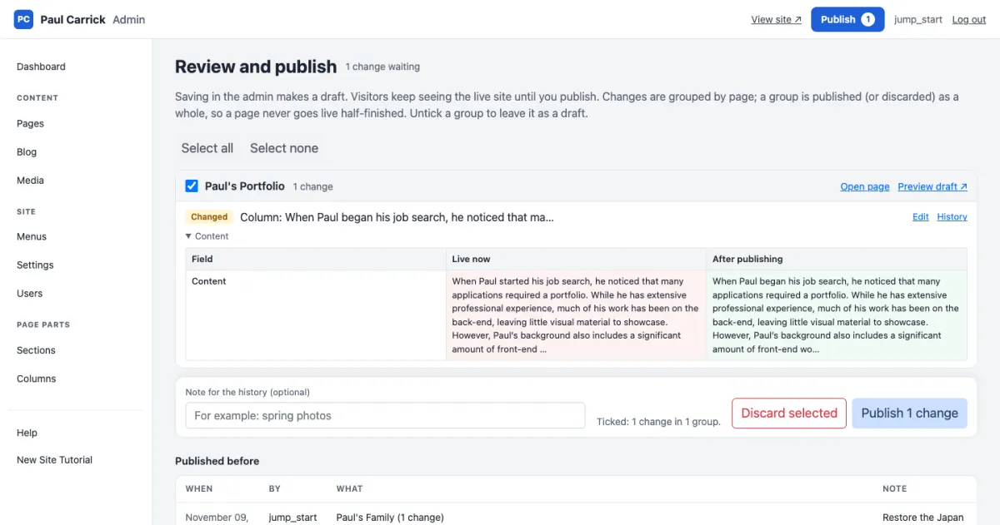

### How to throw away changes you do not want

1. Choose **Publish** in the top bar.
2. Tick only the groups you want to throw away.
3. Choose **Discard selected** and confirm. The drafts are deleted and the live site stays as it is.

### Good to know

- If someone saves a change in a ticked group after you opened the page, nothing is published and you are asked to review again.
- Several administrators share one set of drafts, so agree before publishing or discarding someone else's work.
- **Published before**, at the foot of the page, lists each publish: when, by whom, what it contained and its note.

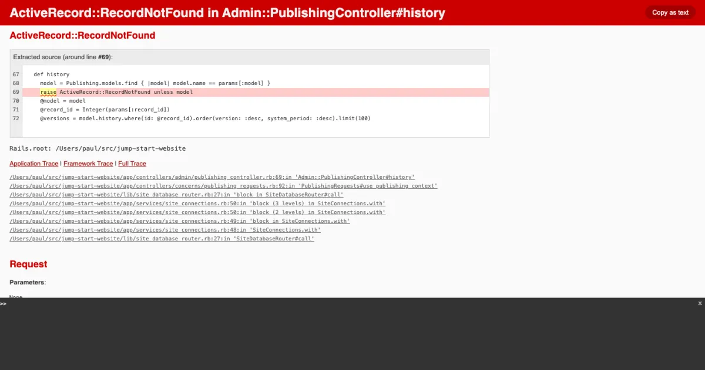

## Using list pages

Pages, Blog, Users, Settings, Sections and Columns are lists that all work the same way.

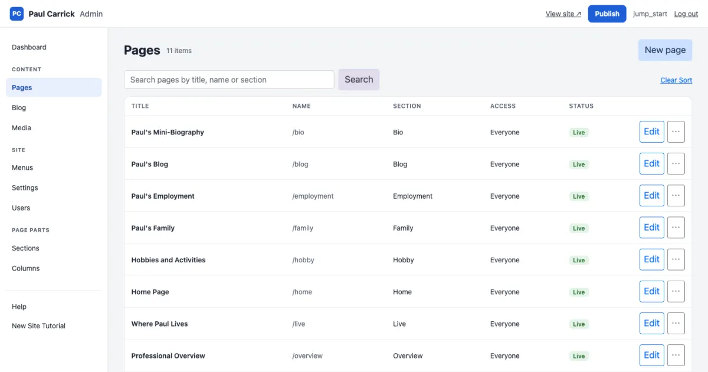

- The heading shows how many items there are and the **New …** button.
- **Search:** type in the search box and choose **Search**. **Clear** removes the search. (The Blog list has separate Title, Author, Contents and Posted boxes.)
- **Sort:** click a column heading to sort by it; click it again to reverse. The arrow shows the current sort. **Clear Sort** goes back to the normal order.
- **Edit** opens the item.
- **⋯** opens a menu with **View**, **History** and **Delete**. For pages it also holds **Classic editor**.
- **First**, **Previous**, **Next** and **Last** move between pages of results.

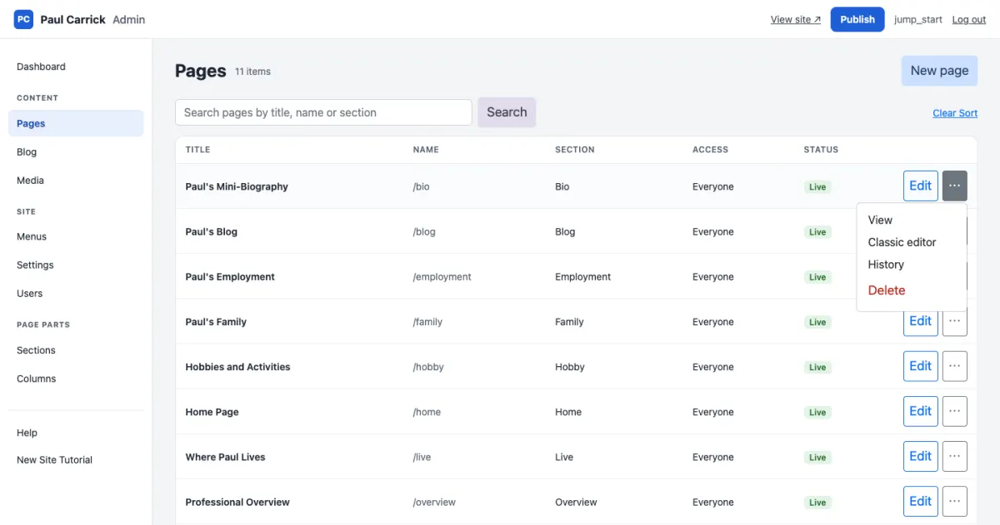

### How to delete something

1. Find it in its list.
2. Choose **⋯**, then **Delete**, and confirm.
3. The deletion is a draft. Choose **Publish** to remove it from the site, or **Discard selected** on Review and publish to keep it.

Deleting a section also removes its columns. Something that was never published (a new section you cancelled, for example) is removed at once, with what is inside it, and leaves nothing to publish.

## Pages, sections, and columns

Every page is built from three levels:

- A **page** is one address on the site, such as `/portfolio`. It has a title, a name (the address) and an access setting.
- A **section** is a block on the page, one under the other. Each section holds one or more columns.
- A **column** holds text, a picture, a video, or text with a picture.

A page's **Section** field and a section's **Section group** field do different things. The page's Section field names the set of sections shown on that page. A section's Section group ties neighbouring sections together so they move and are duplicated together.

## Pages

### The page workspace

1. Choose **Pages** in the sidebar.
2. Click the page's title (or **Edit**). The workspace opens.

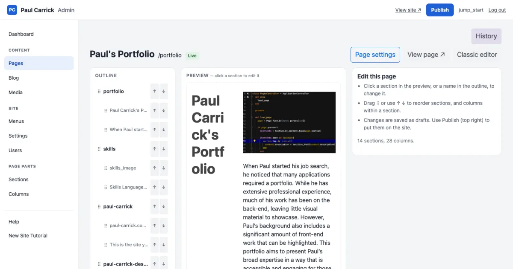

The workspace has three parts:

- The **outline** (left) lists the sections (bold) and the columns in each. Click a name to edit it.
- The **preview** (middle) shows the page as it will look. Click a section to select it. Links in the preview do not take you away.
- The **panel** (right) edits whatever you selected.

At the top: **History**, **Page settings**, **View page ↗** (the live page in a new tab), **Full-window editor ↗** and **Classic editor** (the older page editor).

### How to edit in a full window

The editor on the right can also fill a whole window, which gives long text and wide layouts more room.

1. In the workspace, choose **Full-window editor ↗**. It opens in a new tab on whatever you were editing: a column, a section, or the page.
2. Use **Editing** at the top to choose another section or column, or **The page** for the page's own settings (title, name, access, section) and **+ Add section**.
3. Edit and save as usual; you stay in the full window.
4. **← Back to the workspace** shows the outline and the preview again, on the same item.

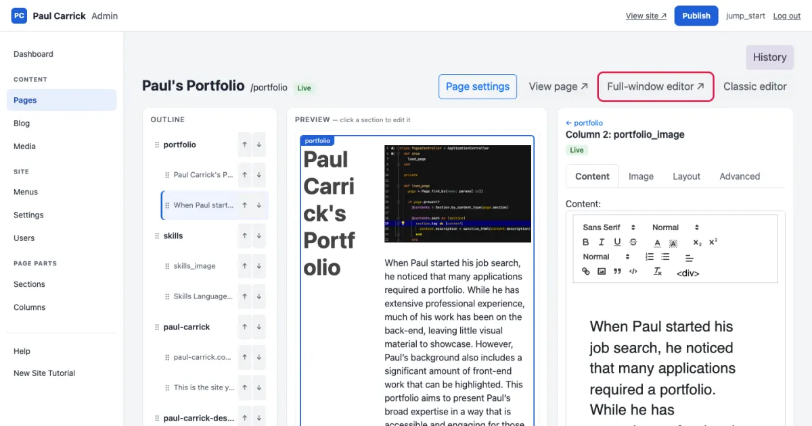

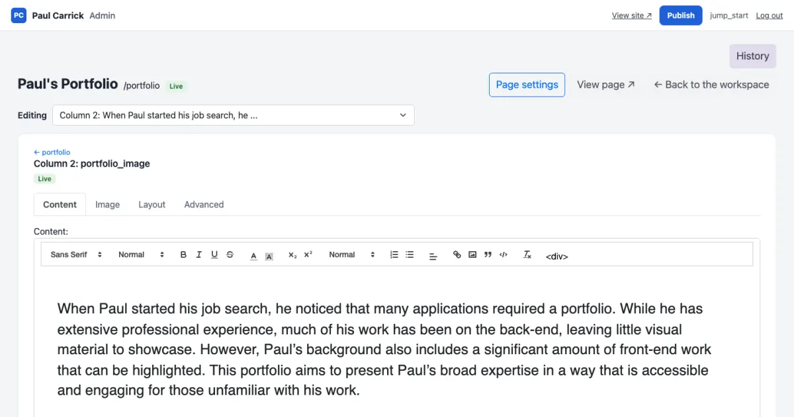

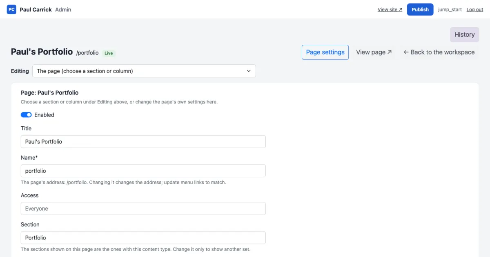

### How to change a page's title, address or access

1. Open the page's workspace and choose **Page settings**.
2. Change what you need:
   - **Title**: the name shown in the browser tab and in lists.
   - **Name**: the page's address (`portfolio` is `/portfolio`). Changing it changes the address, so update menu links to match.
   - **Access**: who may see the page. Leave it empty for everyone.
   - **Section**: which set of sections the page shows. Change it only to show another set.
   - **Enabled**: switch off to hide the whole page.
3. Choose **Save Page**, then publish.

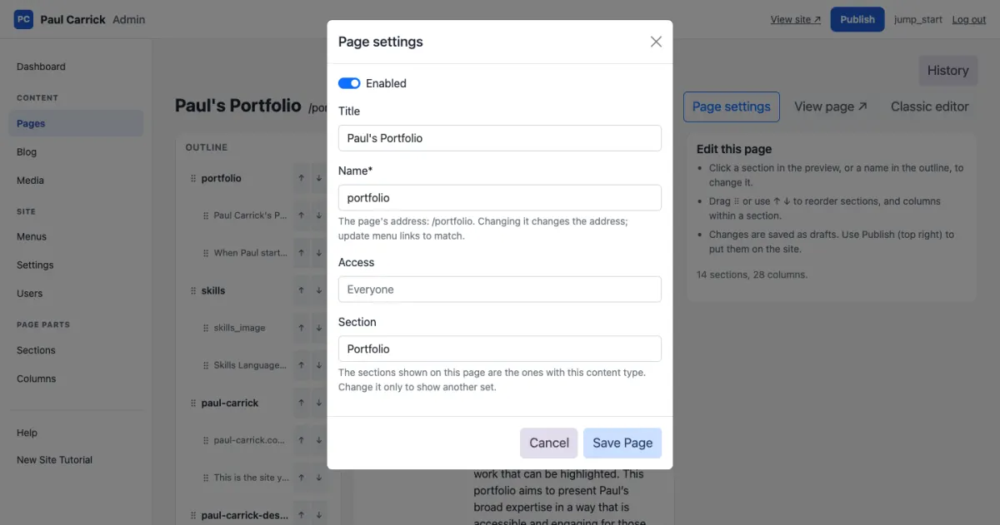

### How to change the text of a column

1. Open the page's workspace.
2. Click the column's name in the outline (the lighter names under each section), or click the section in the preview and then the column in the panel's list.
3. The panel opens on the **Content** tab. Change the text in the editor.
4. Choose **Save Column**. The preview updates.
5. Publish when you are ready.

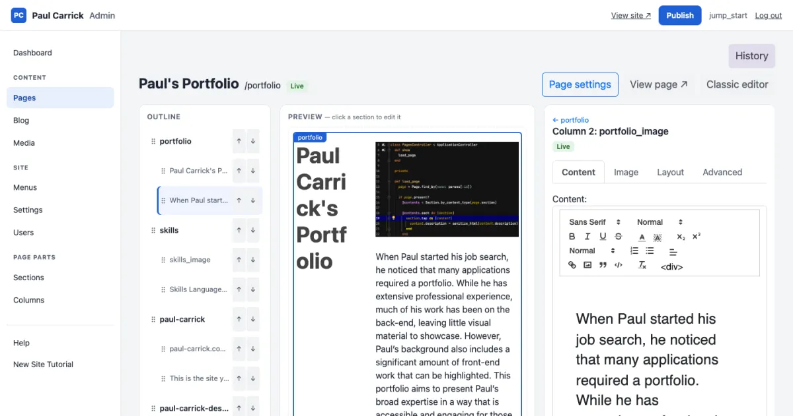

The panel has four tabs:

- **Content**: the text (with **Switch to HTML View**) and the column's link.
- **Image**: the picture, slide show (an image group) or video, chosen from one list, with **New Image** and **Remove**.
- **Layout**: the formatting fields (margins, background, image and caption classes and styles).
- **Advanced**: Enabled, the column's name and its order.

A small preview of the column sits under the tabs. **Delete this column** removes it.

### How to choose a column's picture, slide show or video

1. Open the page's workspace and click the column's name in the outline. A picture column opens on the **Image** tab; for any other column, choose the **Image** tab.
2. Click **Picture, slide show or video**. The list has three parts:
   - **Slide shows (image groups)**: every image group, with how many pictures it has. The column shows them one after another, in the group's slide order (set it in Media; see [How to put a group's pictures in order](#how-to-put-a-group-s-pictures-in-order)).
   - **Videos**: the MP4 videos in Media. The column shows the video with play controls.
   - **Pictures**: every picture in Media.
3. Choose one, or type part of its name to find it. The line under the list says what the column will show.
4. To give the pictures rounded corners, tick **Round the picture corners** (for a slide show, **Round the corners of the group's pictures**). It is not offered for videos.
5. Choose **Save Column**, then publish.

**Remove** takes the picture, slide show or video off the column (the file stays in Media). **New Image** uploads a new file without leaving the page; it then appears in the list.

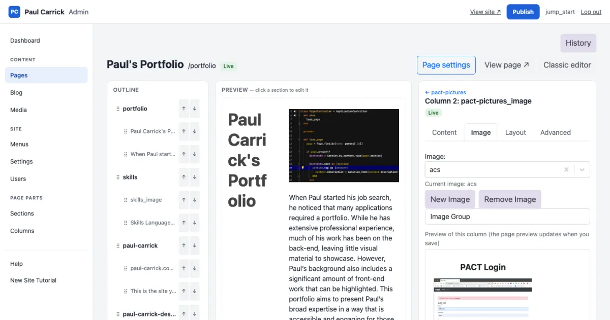

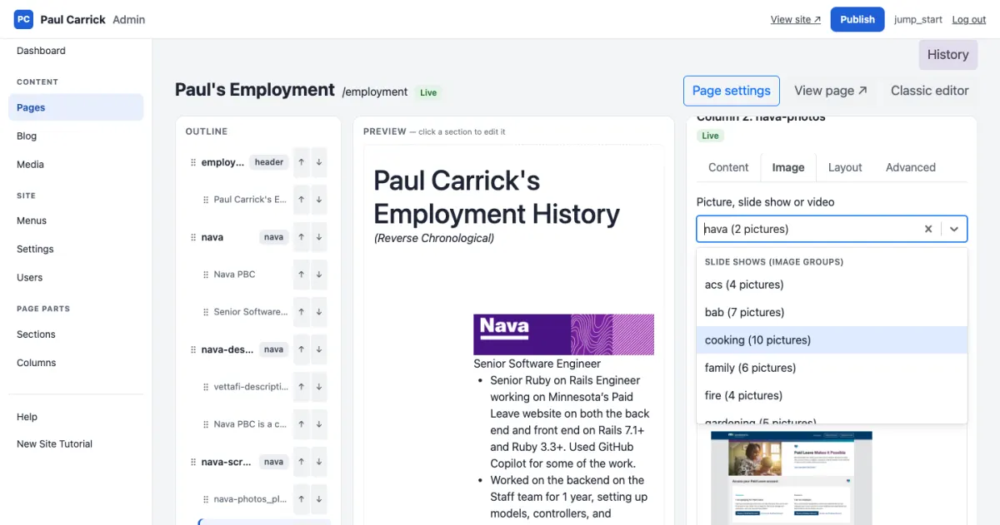

### How to change a column's layout

1. Open the column and choose the **Layout** tab.
2. Use the pickers for margins, colours (from the site's palette) and classes. **Switch to Formatting Mode** shows the raw CSS classes and styles, for advanced use.
3. To put the column in a rounded white box with a soft shadow, tick **Use rounded borders** under the margins. Use **Margin Bottom** for the space under the box. If the column has a **Background Color**, the box keeps that colour instead of white.
4. **Classes** shows the classes the margins and the rounded borders write, and you can type your own there. Untick **Use rounded borders** to take the box away again.
5. Choose **Save Column** and check the preview, on a narrow window too.

The **Advanced** tab holds the column's Enabled switch, its name and its order in the section.

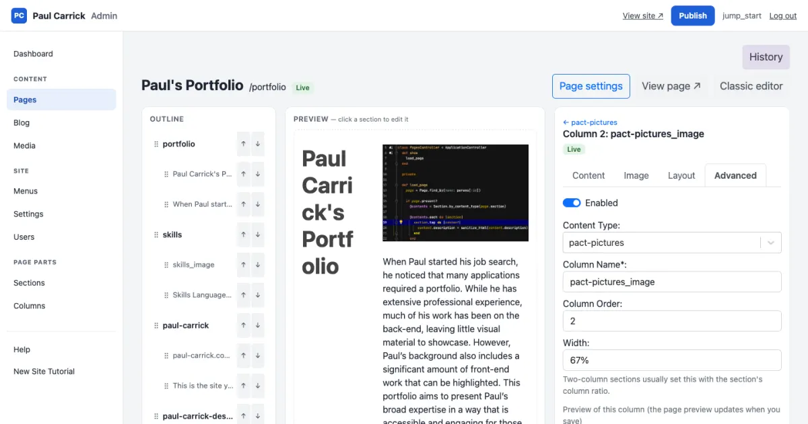

### How to change the order of sections or columns

1. Open the page's workspace.
2. In the outline, choose **↑** or **↓** beside a section or column to move it one place. Or drag its **⠿** handle up or down.
3. Sections move within the page; columns move within their section. The new order is saved as a draft at once and the preview updates.
4. Publish when you are ready.

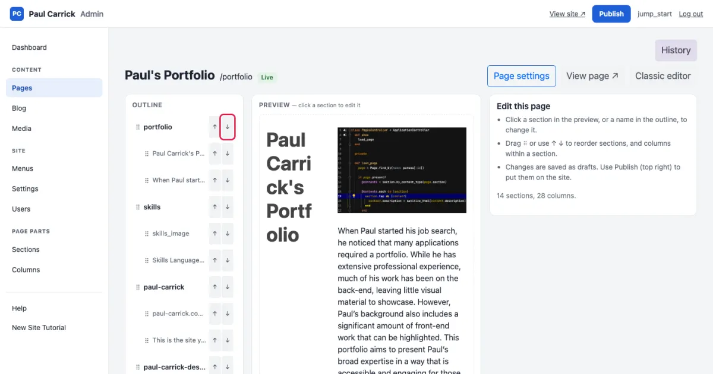

You can also move sections on the page itself: see [Editing from the page itself](#editing-from-the-page-itself).

### How to add a section

1. Open the page's workspace and choose **+ Add section** under the outline.
2. In **Templates**, choose a layout: Text Only, Image Only, Dual Column (text left or right), Three, Four or Five Column, Dual Row (text top or bottom), or Header Section.
3. Fill in what the layout asks for: the text in the editor and, for a layout with a picture, the **Image**.
4. Choose **Generate Columns**. The new columns appear below.
5. Check the columns. Set the section's name, its **Section group** if it belongs with others, and its order. For two columns, **Div Ratio** sets their widths (for example 50:50 or 7:5); choose **Apply Ratio** to see it.
6. Choose **Save Section**. You return to the workspace.
7. Publish when you are ready.

**Cancel** removes the new, empty section.

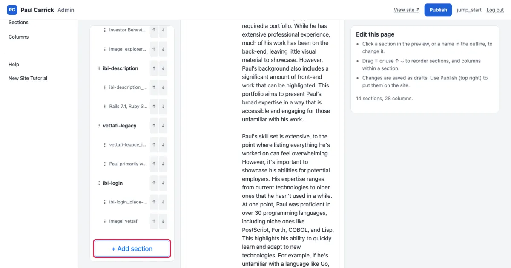

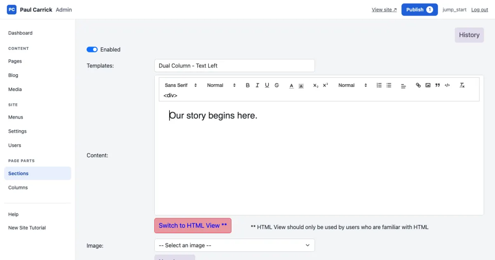

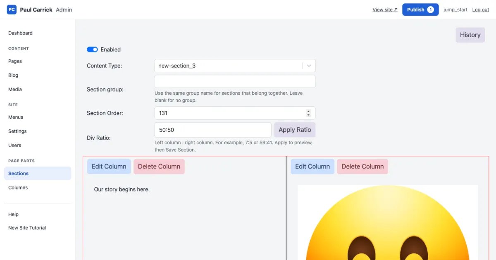

### How to edit a section

1. Open the page's workspace and click the section's name (bold) in the outline, or click the section in the preview.
2. The panel shows the section: **Enabled**, **Section name**, **Section group** and its **Columns**.
3. Change what you need and choose **Save section**.

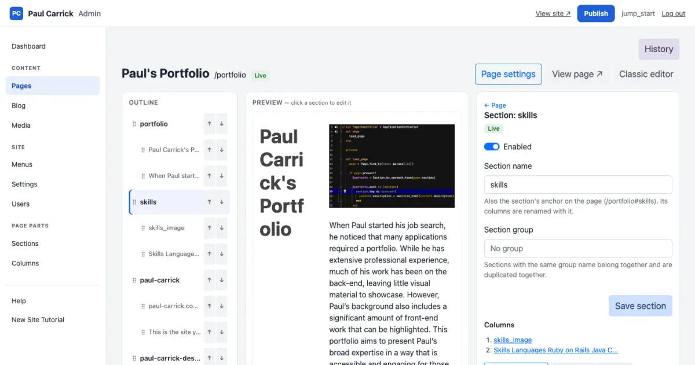

Further down the panel:

- **+ Add column** adds an empty text column at the end.
- **Edit section layout** opens the classic section editor (name, order and column widths).
- **Duplicate**: copy the section, or its whole group, to the end of the page (see [Section groups and duplication](#section-groups-and-duplication)).
- **Delete section** removes it and its columns.

### How to create a page

1. Choose **Pages**, then **New page** (or **+ New page** on the Dashboard).
2. Fill in:
   - **Page Title**: the name visitors see.
   - **Page Name**: the address, such as `about` for `/about`. It must be unique; choose it carefully.
   - **Section Group**: the name of the page's set of sections, such as `about-us`. Use a new name for a new page.
   - **Page Access**: leave empty for everyone.
3. Choose **Save Page**.
4. Open the new page from the Pages list and use **+ Add section** (see above) to fill it.
5. To let visitors find it, add it to the header menu or footer (see [Menus](#menus)).
6. Publish the page with its sections and columns.

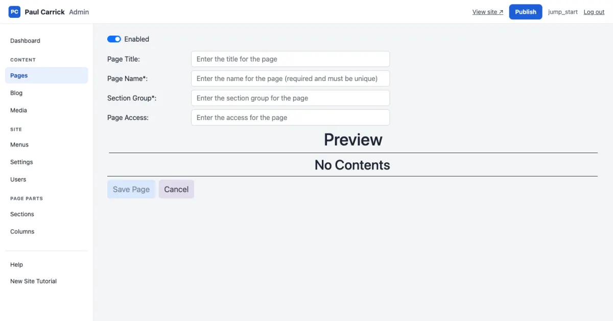

### Section ordering

Sections have order numbers. Moving them in the outline numbers them 10, 20, 30 and so on. The classic editor's **Renumber Sections** does the same for the whole page. Grouped sections stay together when duplicated.

## Editing from the page itself

You can also edit while looking at the real page.

### How to start and finish

1. Signed in as an administrator, open any page of the site and scroll to the bottom.
2. Choose **Edit Page**. The page now shows your drafts, and the button becomes **Editing… Save Changes** with **Cancel** beside it.
3. Make your changes (see below).
4. Choose **Save Changes** to publish the changes you made since you chose Edit Page. Or choose **Cancel** to throw them away (it asks first).

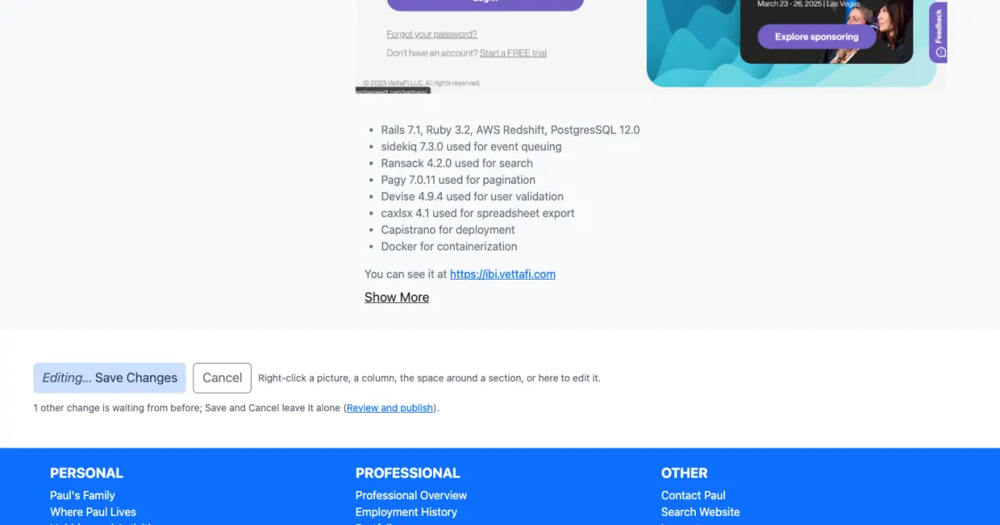

Save Changes and Cancel only touch what you changed after choosing Edit Page. Changes made before, by you or by others, are left alone; the bar says when some are waiting and links to Review and publish.

### How to open the right editor with a right-click

1. While editing, right-click the part of the page you want to change.
2. Choose **Edit** in the small menu. The matching editor opens in a new tab:
   - on a **picture**: the media library, with that picture selected;
   - on a **column's** text or the space beside it: that column in the page workspace;
   - on the **space above or below a section's content**: that section in the page workspace;
   - anywhere else, such as **beside the buttons**: the page workspace.
3. Make the change there and save it.
4. Come back to the page's tab: it reloads and shows what you saved.

On a section, the menu also offers **Duplicate section…** and, for a section in a group, **Duplicate group…** (see [Duplicating from the page itself](#duplicating-from-the-page-itself)).

Hold **Shift** while right-clicking to get the browser's own menu.

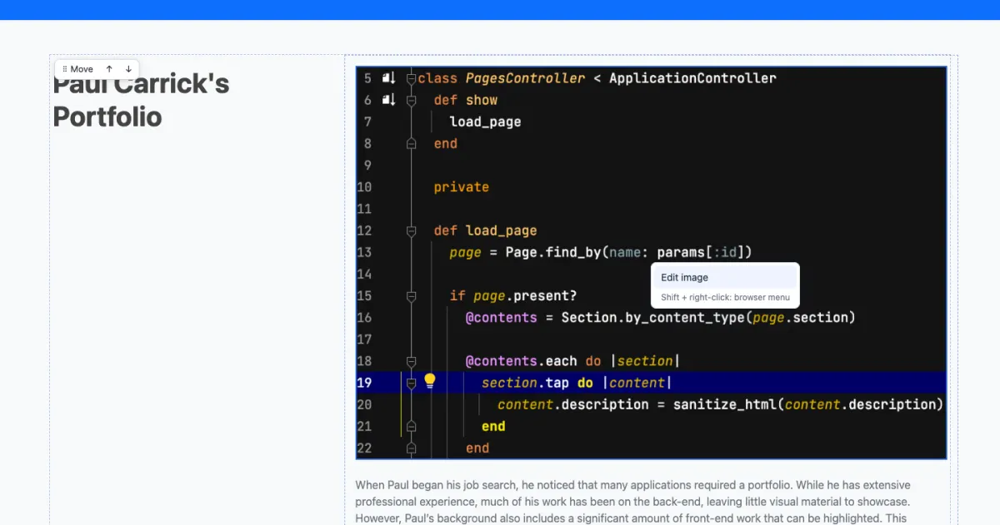

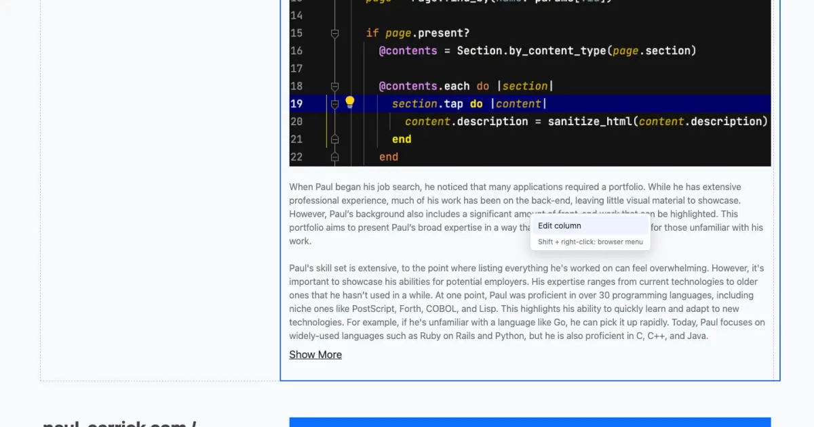

### How to move a section on the page

1. While editing, point at the section. A small handle, **⠿ Move ↑ ↓**, appears in its top-left corner.
2. Drag **⠿ Move** above or below another section, or choose **↑** or **↓** to move it one place.
3. The new order is saved as a draft at once and the page reloads to show it.
4. Choose **Save Changes** to publish it.

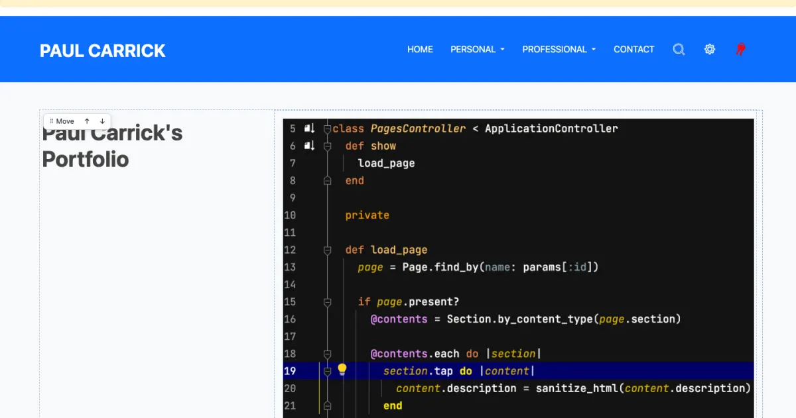

A section with a **Show More** button moves together with the sections it opens (and the sections of one section group move together), so a project never gets split from its hidden part. Moving any one of them gathers the group in one place. A heading that sits in its own section, above the section with the Show More, still moves on its own: move it next to its project afterwards.

Links to the admin in the site's header and footer open it in a new tab.

## Sections

Sections are normally edited from the page workspace (see [How to edit a section](#how-to-edit-a-section)). The **Sections** list under Page parts shows every section of every page, to find one by name.

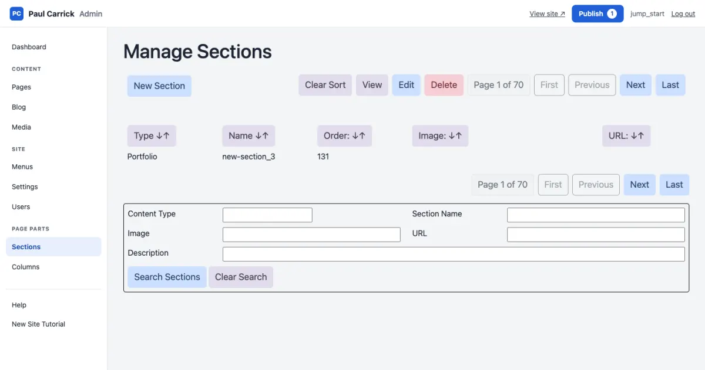

### Section groups and duplication

Give sections that belong together the same **Section group** name. Leave it empty for a section on its own.

#### How to duplicate a section

1. Open the page's workspace and click the section's name in the outline.
2. In the panel, under **Duplicate**, type the **Name for the copy of this section** (it starts as the name with "-copy").
3. Choose **Duplicate section**. The copy, with all its columns, is added at the end of the page and opens in the panel.
4. Move it where you want it and publish.

The copy is not in any group. Its columns are named after it (a copy of "roses" called "tulips" has the column "tulips_text").

#### How to duplicate a whole group

1. Click any section of the group.
2. Under **Duplicate**, type the **Name for a copy of the whole group**. It becomes the new group's name and goes in front of every section's name: copying the group "amazon" as "google" makes "google-amazon" and "google-amazon-description".
3. Choose **Duplicate group**. All the group's sections and columns are copied, in the same order, to the end of the page.

The copies' **Show More** buttons open their own hidden parts, not the original's.

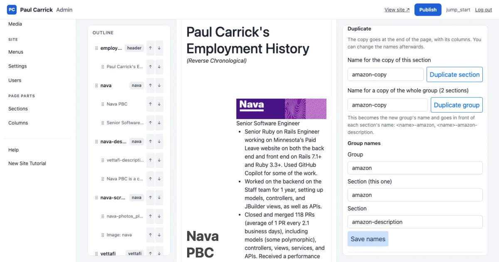

#### How to rename a group and its sections

Under **Group names**, change the group's name and the name of each of its sections, then choose **Save names**. All are renamed together, and each section's columns follow it. This is the quick way to tidy the names of a copied group. A single section is renamed in its **Section name** field above.

A name must not already be used by another section. The page says which name is taken, and nothing is copied or renamed until all the names are free.

#### Duplicating from the page itself

While editing a page on the site (**Edit Page**), right-click a section and choose **Duplicate section…** or **Duplicate group “…”…**. A small box asks for the name and shows what the copies will be called. Choose **Duplicate**: the page reloads at the copies, at the end of the page. **Save Changes** publishes them with your other changes; to rename them, right-click a copy and choose **Edit section**.

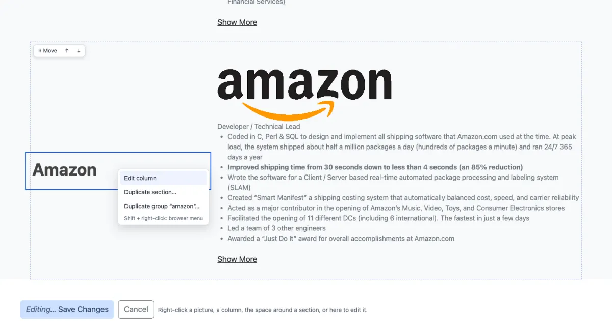

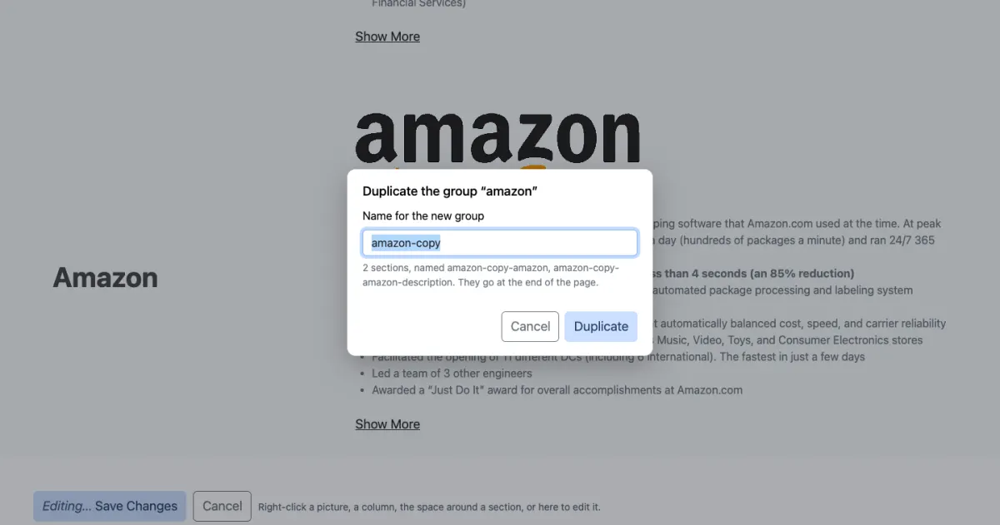

## Columns

Columns are normally edited in the panel of the [page workspace](#the-page-workspace). The **Columns** list under Page parts shows every column with a small preview and can open the classic column editor, which has the same fields on one long form.

**Moving a column to another section.** In the classic column editor, **Section this column belongs to** moves the column into the section you choose; it does not rename anything. While a move is set, a yellow note says where the column will go (with **Keep it in …** to undo it), and **Save Column** asks before moving it. To rename a section, change its **Section name** in the section's panel in the page workspace; its columns go with it. (In the page workspace a column's section cannot be changed.)

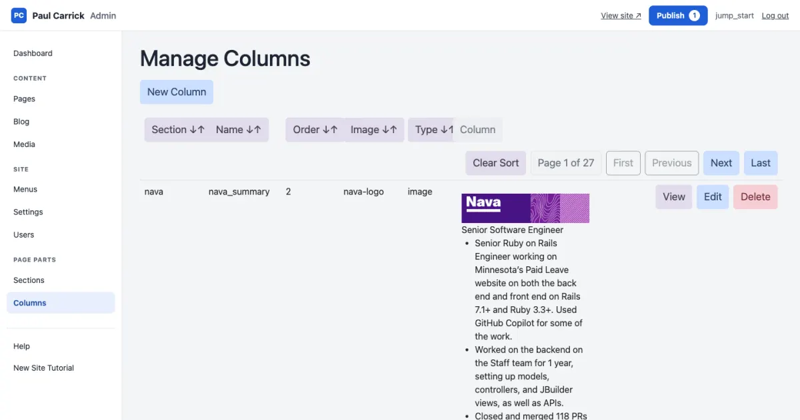

## Writing and formatting content

The text editor works like a word processor: use its toolbar for headings, **bold**, *italic*, underline, lists, links, quotes and pictures, then save.

- **Switch to HTML View** shows the page's code (HTML) for advanced editing. Use it only if you know HTML, then switch back and check the result.
- Formatting fields (the **Layout** tab) offer pickers for margins, colours from the site's palette, and classes. **Switch to Formatting Mode** shows the raw CSS classes and styles.
- Some content uses **Show More** and **Show Less** to hide part of a project until it is clicked. Check both the closed and the open view on the site. When sections are styled as rounded boxes, an open Show More and the sections it opened join into one box.
- To link a video stored in Media, type `VideoImage:"name"` in a column's text, using the video's name. The page shows a link, labelled with the video's caption, that plays it.

### How to check spelling and grammar

Every text editor in the admin (columns, blog posts and picture captions) has a **Check spelling and grammar** button under it.

1. Write or change the text, then choose **Check spelling and grammar**.
2. Possible problems are underlined in the text, **red** for spelling and **blue** for grammar, and listed under the button with an explanation.
3. For each one, click a suggestion (for example **mistakes**) to change the text, keeping its formatting. Click the word in quotes to select it in the text, or **Ignore** to leave it as it is. **Ignore all** appears when the same word is flagged more than once, which is handy for names.
4. Save the column or post as usual. Fixes change only the editor's text until you save.

If you type in the editor after a check, the results are cleared, because their places are no longer right; check again to see what is left.

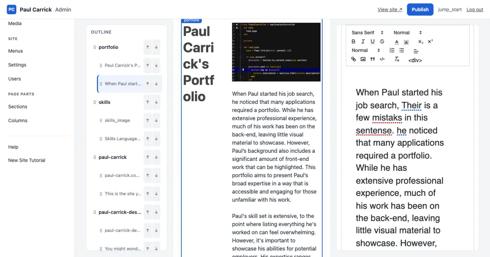

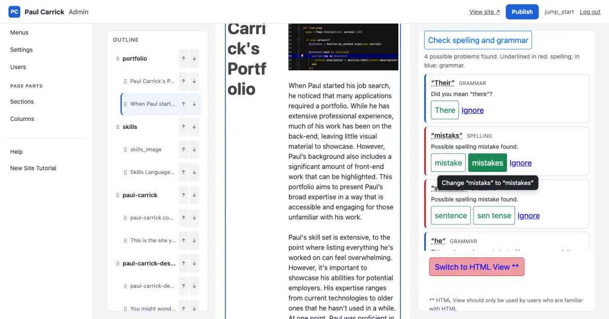

The check is done by LanguageTool, a free, open-source checker. The text is sent to LanguageTool's public service unless the site has its own copy (`LANGUAGETOOL_URL` in the server's settings), so check only text that may be public. Names and technical words are often flagged as spelling mistakes; use **Ignore**. The public service allows a limited amount of text a minute; if it is busy, wait a minute and try again.

## Image files and groups

### The media library

Choose **Media** in the sidebar. Files are shown as thumbnails, newest first, 24 to a page. Videos show a ▶ mark; hidden files are faded.

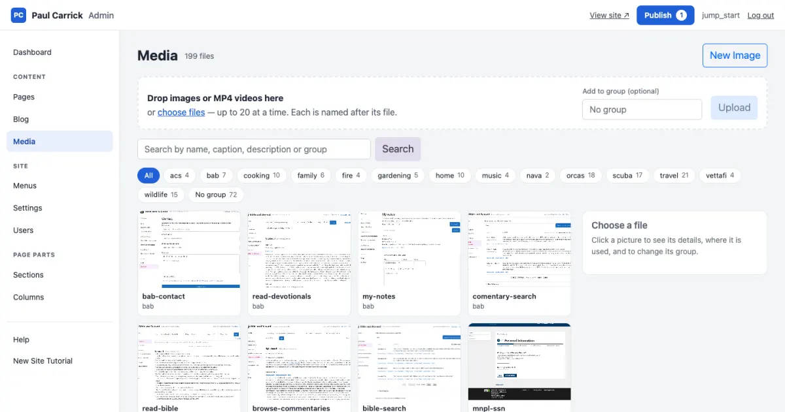

### How to find a picture

1. Choose **Media**.
2. Click a **group chip** (each shows how many files it has) to see only that group, **No group** for files without one, or **All** for everything.
3. Or type part of a name, caption, description or group in the search box and choose **Search**.

### How to change a picture's caption, group or order

1. Click its thumbnail. Its **details** open on the right: the file, its caption and description, and **Used on** (the pages that show it).
2. Change **Group**, **Slide order** or **Enabled** and choose **Save**. Choosing another group fills in the next slide number, so the picture goes to the end of that group's slide show.
3. To change the caption, description or the file itself, choose **Edit caption, description or file**. Save there, and you return to the library.
4. Publish when you are ready.

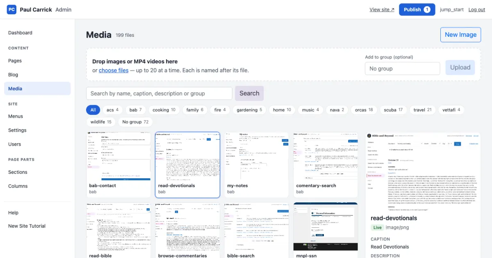

**View**, **History** and **Delete this file** are in the details too. Delete warns you when the picture is used on a page.

### How to put a group's pictures in order

A group's pictures are shown as a slide show, in their slide order. To change it:

1. Choose **Media**, then click the group's chip (for example **travel**).
2. **Slide show order** appears above the pictures: one rounded box per picture, with its number, a small thumbnail and its name.
3. Drag a box to its new place. The others move aside as you go. Or click a box and use **←** and **→** (**Home** and **End** move it to the start or the end).
4. Let go. The new order is saved as a draft at once ("Saved as a draft") and the pictures below follow it.
5. Publish when you are ready.

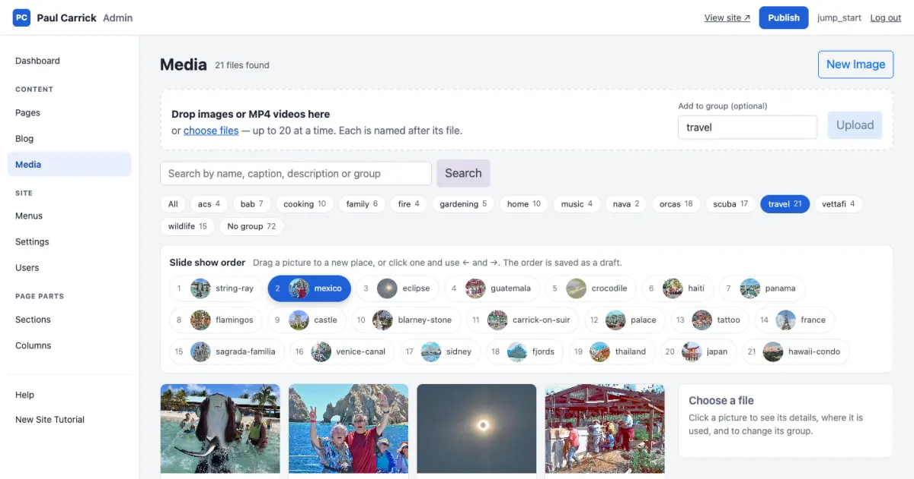

Hidden pictures stay in the list, faded, so their place is kept. Uploading to a group adds the new pictures at the end; drag them into place afterwards.

### How to upload pictures or videos

1. Choose **Media**.
2. Drop the files on the area that says **Drop images or MP4 videos here**, or choose **choose files**. Up to 20 at once.
3. To add them to a slide show, type the group's name in **Add to group (optional)**.
4. Choose **Upload**.

Each file is named after itself without its extension (`garden.jpg` becomes `garden`). If the name is taken it gets "-2", "-3" and so on, because pages find pictures by name. Anything that is not a picture or an MP4 video is skipped with a message.

**New Image** (top right) adds one file with its caption and description on the full form. A picture's name cannot be changed later, because pages refer to it.

### How to upload while editing a column

1. In the column's **Image** tab, choose **New Image**.
2. Choose the file, fill in its caption and save. You return to the column with your draft still there.
3. Choose the new picture in **Image** and choose **Save Column**.

Uploading saves the picture on its own: cancelling the column does not remove it.

Image groups and section groups are different things, even when they have similar names.

## Blogs

Choose **Blog** in the sidebar. The list shows each post's title with the start of its text, its author, type, posted date and status, 20 to a page. Search by title, author, contents or posted date (YYYY-MM-DD).

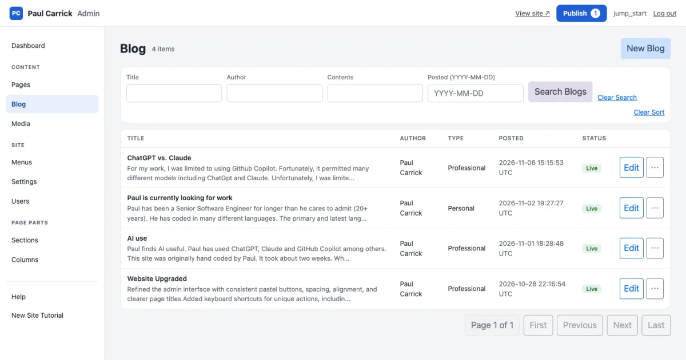

### How to write a blog post

1. Choose **Blog**, then **New Blog** (or **+ New blog post** on the Dashboard).
2. Fill in:
   - **Author** (filled in with your name) and **Title**.
   - **Visibility**: Public for everyone.
   - **Blog Type**: which blog it belongs to, such as Personal or Professional.
   - **Posted**: the date shown on the post. Posts are listed newest first.
   - **Post**: the text, with the same editor as columns.
3. Choose the **Save** button at the bottom, then publish.

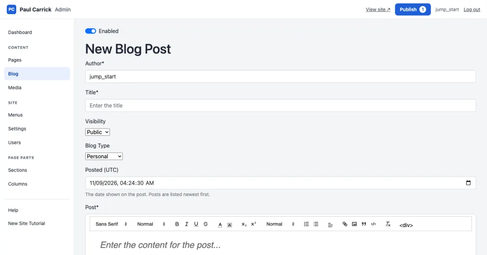

To change a post, choose **Edit** beside it in the list, make the change, save and publish.

## Menus

Choose **Menus** in the sidebar to arrange the **Header menu** and the **Footer**. Switch between them at the top. Each is shown as a tree of up to two levels, like on the site: top items, and items inside them (a dropdown in the header, a column in the footer).

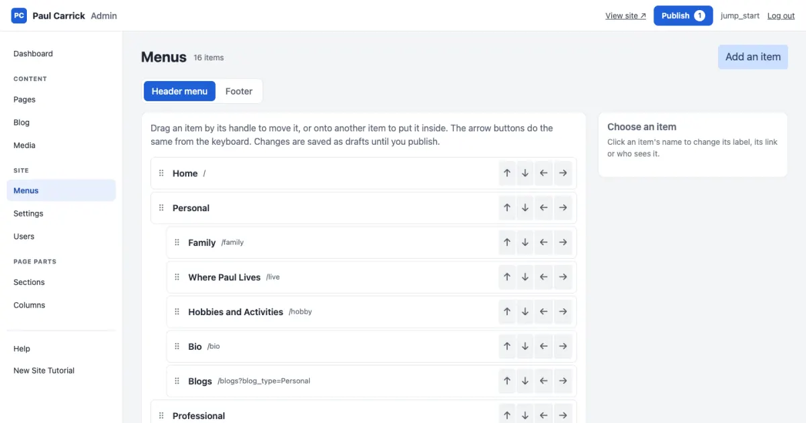

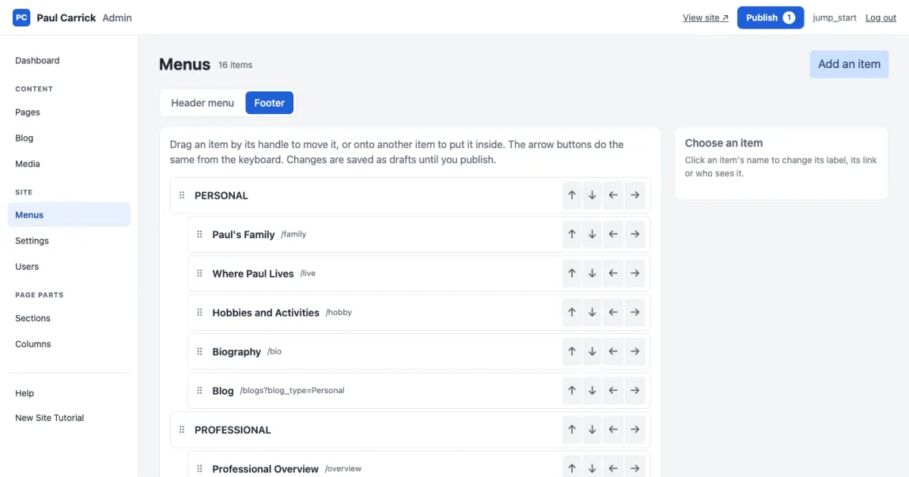

### How to add a menu item

1. Choose **Menus** and pick **Header menu** or **Footer**.
2. Choose **Add an item**.
3. Type the **Label** (the words visitors see).
4. In **Links to**, choose one of the site's pages, or type an address such as `https://example.com` or `mailto:you@example.com`.
5. Choose **Add item**. It is added at the end.
6. Move it into place (see below) and publish.

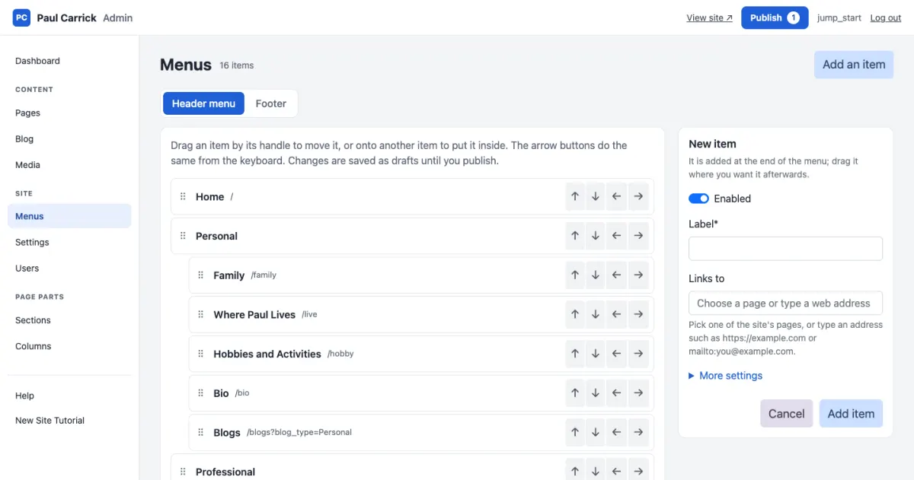

### How to change or remove a menu item

1. Click the item's name. The panel shows **Enabled**, **Label**, **Links to** and, under **More settings**, Access, Icon and Options.
2. Change what you need and choose **Save item**.
3. To remove it, choose **Delete this item**. Items inside it move to the top level.

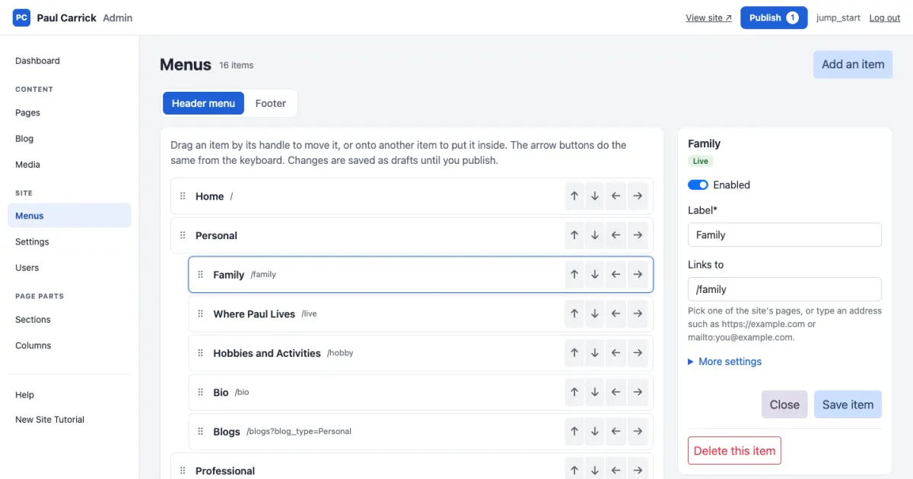

### How to move a menu item

- **↑** and **↓** move it up or down.
- **←** moves it out one level; **→** puts it inside the item above (as a dropdown entry or footer link).
- Or drag its **⠿** handle above, below or onto another item.

The links at the bottom of the admin sidebar (Help, Video Tutorial, New Site Tutorial) are menu items of the type **Help**. Change, hide or add them on the old **Menu Items** list (**Show the header menu as a list** at the foot of the Menus page).

Each move is saved as a draft at once. Items that link to `/admin` can be moved (with the buttons, the handle or their panel) but their label and link cannot be changed. Addresses that could run code are refused.

## Users and access

Choose **Users** in the sidebar to create accounts and change names, email addresses, access and roles.

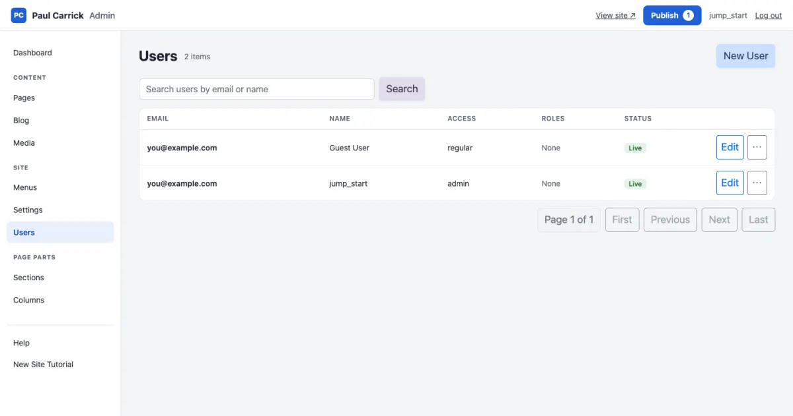

### How to add a user

1. Choose **Users**, then **New User**.
2. Fill in **Email**, **Name** and **Password**.
3. Choose **Access**: **Regular**, **Read Only**, **Post Blogs** (may write posts), **Administrator** or **Super User**. Administrators and super users can change content and publish.
4. **Roles** is a separate field used by page and menu rules; leave it empty if you do not use it.
5. Choose **Save User**, then publish. Tell the person their password privately.

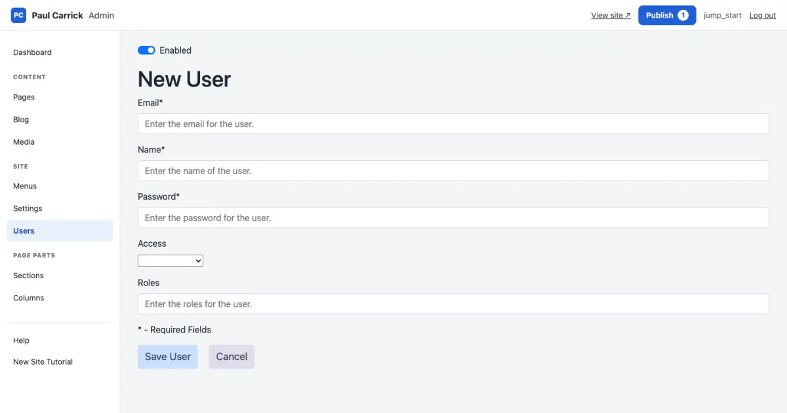

Visitors cannot sign up themselves; administrators create accounts here. When editing a user, leave the password fields empty to keep the current password. A new password or access level is a draft until published.

## Site setups

**Settings** in the sidebar holds the site's configuration: one form in tabs, with one **Save**.

### How to change the site's settings

1. Choose **Settings**, then **Edit** beside the site.
2. Choose a tab and change what you need (each tab is described below).
3. Choose **Save Site Setup**. If a required field on another tab is empty, Save opens that tab.
4. Publish the Settings group.

**General**: configuration name, site name, owner, domain, host, address (Site URL) and the copyright line. Changing the configuration name suggests the site name, owner, address and database.

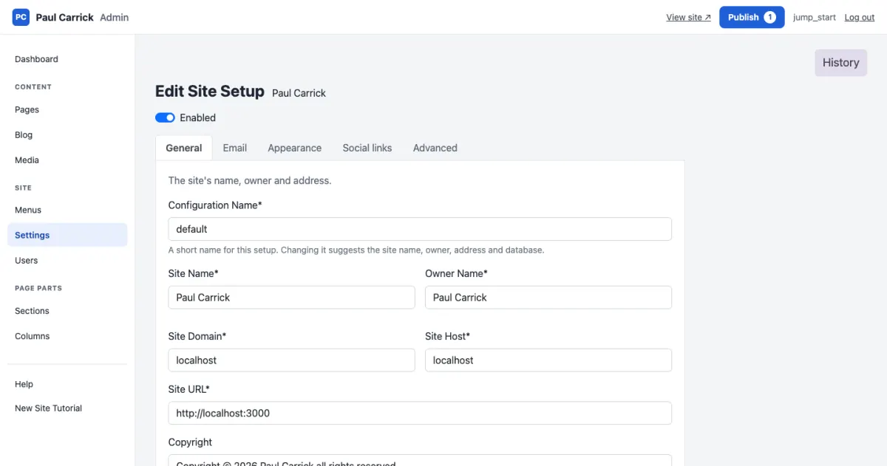

**Email**: the mail server the contact form sends through, and where those messages go (from and to addresses and the subject line). **Send a test email** sends a short message to the "to" address using the settings as last saved and says whether it worked; save first if you changed them.

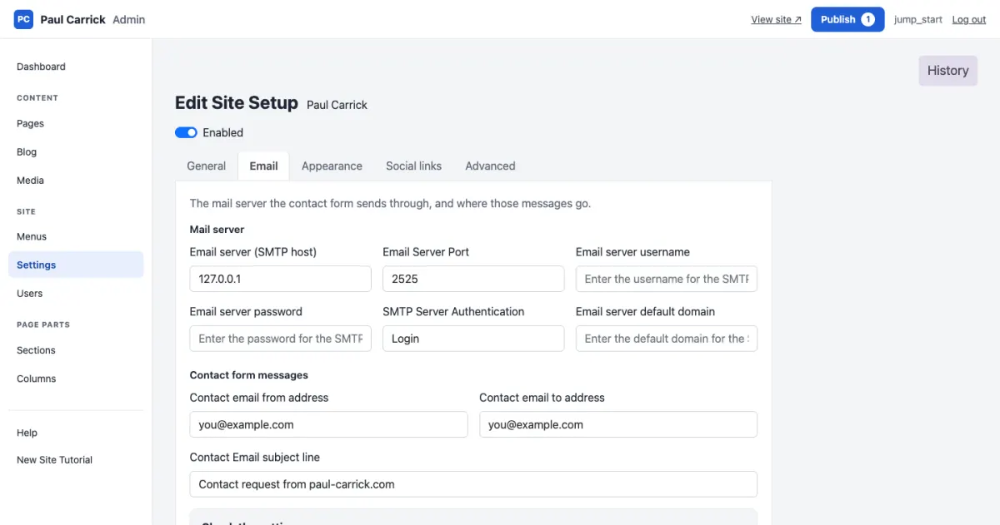

**Appearance**: header, page and footer colours, each with a swatch and a small preview, where the menu sits (see below), and the background picture.

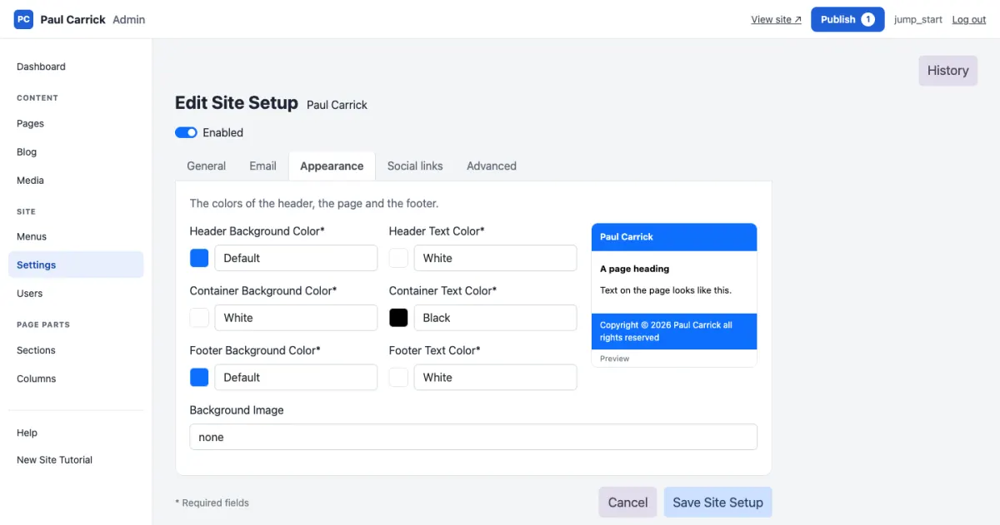

**Social links**: the footer's social icons. Leave a box empty to hide its icon.

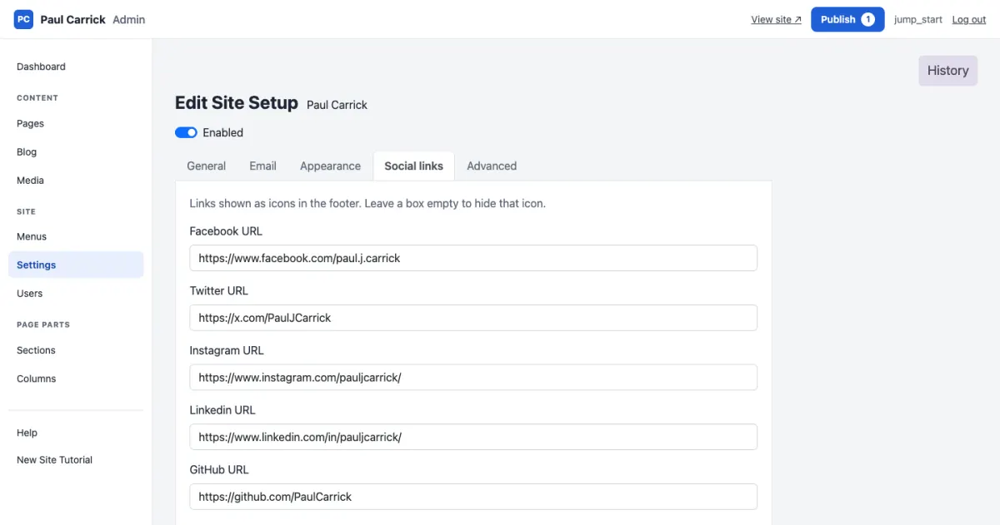

**Advanced**: the database, the guest user's name and the default setup.

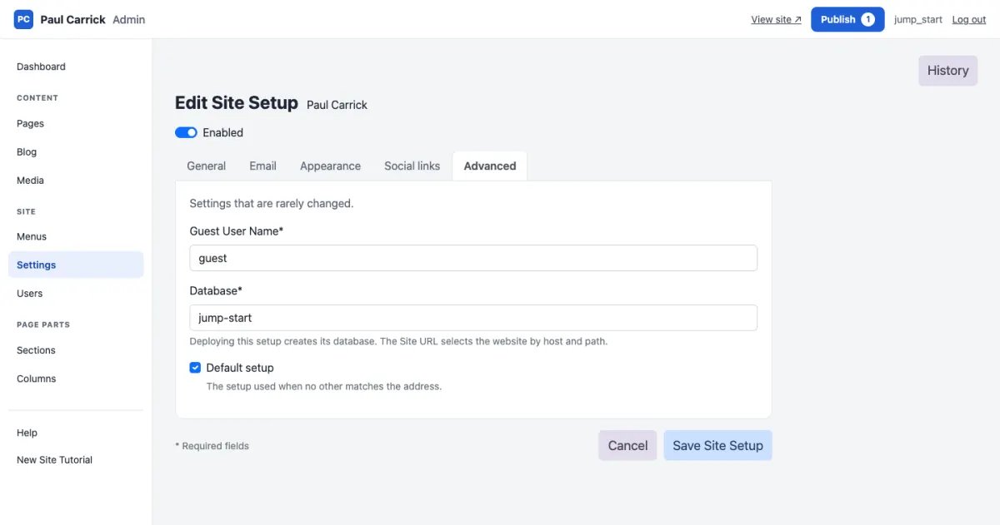

The required **Database** field holds a database name and defaults to `paul-carrick`. Changing it does not rename the running database. Publishing a new, non-default setup creates that database and its first accounts; saving a draft does not. See [Site databases](site-databases.md) for the details. The site is chosen by the Site URL's host name.

Agree changes to domains, email settings or the default setup with whoever runs the server; some settings also come from the server itself.

### How to move the site's menu

The site's menu can sit along the top (the normal place), down the left or right side, or along the bottom of the screen.

1. Choose **Settings**, then **Edit** beside the site, then the **Appearance** tab.
2. Under **Menu position**, click **Top**, **Left sidebar**, **Right sidebar** or **Bottom bar**.
3. Choose **Save Site Setup**.
4. Choose **Publish** in the top bar and publish the Settings group. Visitors see the menu in its new place at once.

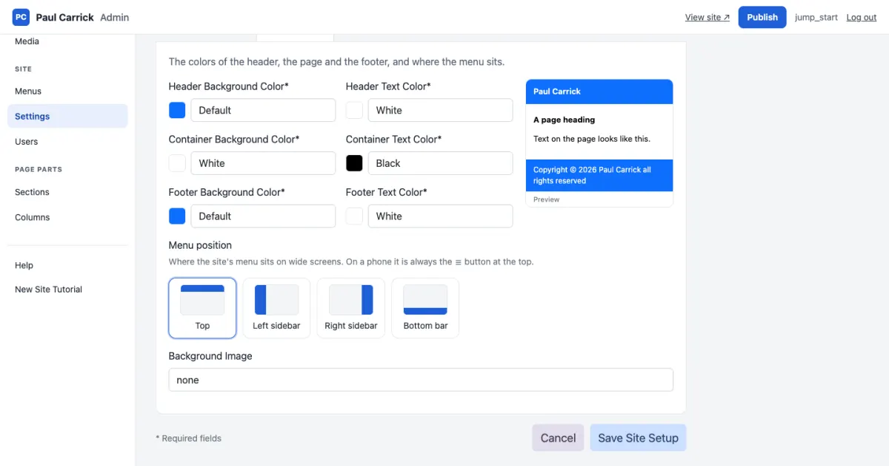

In a sidebar, a menu with items inside it (such as Personal) opens beside the sidebar; in the bottom bar it opens upwards. The admin always keeps its own layout, and on a phone or other narrow screen the menu is always the ☰ button at the top, wherever it is set.

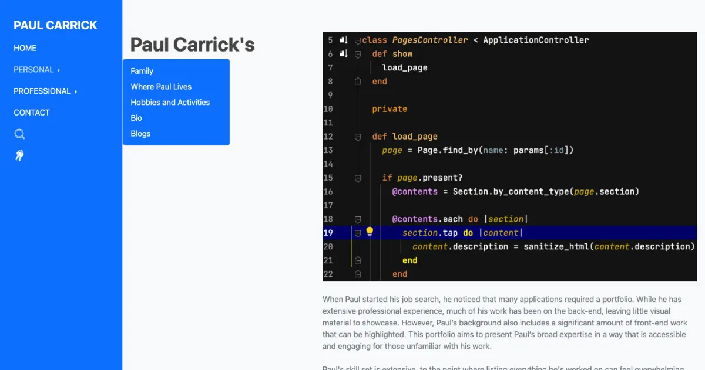

## History and restoring an earlier version

Everything keeps its earlier versions.

### How to go back to an earlier version

1. Open the record (a page, column, picture, menu item and so on) and choose **History**, top right. Or choose **⋯**, then **History**, in its list.
2. Find the version you want. **Valid period** is when it was on the site; **Recorded period** is when it was saved.
3. Choose **Restore as Draft** beside it. It becomes a draft.
4. Check it on **Review and publish**, then publish it.

Passwords and secret settings are never restored.

## Keyboard shortcuts

On Chrome for Mac, use **Control + Option + letter**. Elsewhere, the hint shows **Alt + Shift + letter**. Point at a button to see its shortcut.

- **S**: Save.
- **Escape**: Cancel (with no other key).
- **C**: Clear Sort.
- **N**: New or Next, when only one button matches.
- **V**: View, **E**: Edit, when only one button matches.
- **F**, **P**, **L**: First, Previous, Last, when only one button matches.

A shortcut is left out when several visible buttons would share the key (for example the Edit button on every row), and greyed-out buttons have none. Escape closes an open dialog, menu or list first, before it cancels the form.

## Common questions

### Why don't visitors see my change?

It is still a draft. Choose **Publish** in the top bar, check that its group is ticked, and publish it.

### Why is Save greyed out?

The form is not ready: for a new section, choose **Generate Columns** first. Some accounts are also not allowed to save.

### Can I publish one page and not another?

Yes. On **Review and publish**, untick the groups to leave as drafts. A page's own changes (its settings, sections, columns and menu entries) are published together.

### Why did publishing say "Review them again"?

Someone saved a change in a ticked group after you opened the page. Nothing was published. Look at the list again and publish.

### I moved a section and the Show More disappeared

A project's heading and the section with its Show More may be separate sections. Move the heading back next to its project; the Show More and the hidden parts move together.

### Why is a keyboard shortcut missing?

The button may be greyed out, or several visible buttons share the key. Use the mouse, or Tab and Enter.

### How do I link to one part of this guide?

Each heading has its own address. For example, Pages is `/admin/help#pages` and Media is `/admin/help#image-files-and-groups`.

[Back to table of contents](#table-of-contents)
