# Build your first Jumpstart website

This walkthrough takes you from a new installation to a home page and an About page with text and images. Choose one installation path, then follow the shared editing steps. If Jumpstart is already running, start at **Edit your Site Setup** below. Use Help for the full reference; this tutorial sits immediately below Help in the admin sidebar.

## Choose your installation

Use the native path when you want Rails and PostgreSQL installed on your computer or server. Use containers when you want Docker to run those dependencies for you. Start with a new installation, not an existing production database. The quick-start Compose setup is separate from the legacy production deployment scripts.

## Path A: native installation from the repository

1. Install Git, PostgreSQL 15 or newer, the Ruby version in `.ruby-version` (currently 4.0.7), and Node.js 22.12 or newer. You also need the development libraries for PostgreSQL, YAML, and libvips, and a compiler for native gems. Start PostgreSQL. Operating-system package names differ; the repository's installation scripts provide a Debian-oriented assisted installation if you prefer that route.
2. Download the source and enter its directory:

```
git clone https://github.com/PaulCarrick/jump-start-website.git
cd jump-start-website
```

3. Install the dependencies:

```
gem install bundler -v 4.0.20
bundle install
npm ci
```

4. Create a PostgreSQL login for this local installation. Run the following as a PostgreSQL administrator, then enter a new password when prompted:

```
createuser --pwprompt --createdb jump_start
```

The role must be permitted to load the schema and its extensions. If schema loading reports an extension permission error, ask the database administrator to grant the required permission or install the extension; do not ignore the error.

5. Copy `example.env` to `.env`. Keep that file private. Set DB_HOST to `localhost`, DB_PORT to `5432`, DB_USERNAME to `jump_start`, DB_DATABASE to `jump_start`, and DB_PASSWORD to the password you just chose. Set RAILS_ENV to `development`, SERVER_HOST to `localhost`, SERVER_PORT and INTERNAL_PORT to `3000`, SERVER_MODE to `http`, and SSL_MODE to `false`. Leave DOCKERIZED unset. Set USER_PASSWORD to a strong, unique initial account password. Values containing spaces must be quoted because the next step loads this file in your shell.
6. Load your settings and prepare the database. The preparation flag lets models load before their tables exist; it applies only to this command:

```
set -a
. ./.env
set +a
ASSETS_PRECOMPILE=1 bundle exec rails db:prepare
bundle exec rails db:seed
npm run build
npm run build:css
bundle exec puma -C /dev/null -b tcp://127.0.0.1:3000
```

7. Open `http://localhost:3000`. Sign in with `jump_start@example.com` and the USER_PASSWORD you supplied. The native seeds also create `guest@example.com` with that password; review both accounts in Users and change their credentials before public use. Keep the terminal open while working; Ctrl+C stops the local server.

This is a local development installation. Public native hosting additionally needs production settings, persistent process management, backups, and HTTPS; do not expose the development server as your public site.

## Path B: two-container installation

1. Install and start Docker with Docker Compose. Install Git and Python 3 for the setup command.
2. Download the repository:

```
git clone https://github.com/PaulCarrick/jump-start-website.git
cd jump-start-website
```

3. Generate private settings, then build and start the two containers:

```
bin/docker-setup
docker compose up -d --build
docker compose ps
```

The setup command creates `.env` without replacing an existing file. If it already exists, inspect it rather than deleting it: it may belong to another installation. Rails prepares the databases and creates the starter site and one administrator automatically. PostgreSQL and uploads use persistent Docker volumes.

4. Wait until both services are healthy. On the first run, downloads and database preparation can take several minutes. Use `docker compose logs rails` if Rails does not become healthy.
5. Open `http://localhost:3000`. Read ADMIN_EMAIL and ADMIN_PASSWORD in your local `.env`, and use them to sign in. Do not share the file or commit it to Git.
6. To stop the installation, run `docker compose down`. To resume, run `docker compose up -d`. Do not add `-v` to the stop command: that deletes the database and uploads.

For a release with published images, obtain the release's Compose file and setup script, generate `.env`, and set JUMPSTART_RAILS_IMAGE and JUMPSTART_DATABASE_IMAGE to the supplied versioned image names. Then run `docker compose pull` followed by `docker compose up -d --no-build`. Use the exact image names provided by the release; older Docker Hub images are not interchangeable with this quick-start setup.

## Edit your Site Setup

We will build a small example called **Willow Studio**. Substitute your own name, wording, and photographs.

The pictures in this tutorial show the paul-carrick.com site; yours will show your own names and content in the same places. Click a picture to open it full size.

1. Sign in and open the admin area. Choose **Settings** in the sidebar, then edit the existing default setup. For your first website, use this starter setup rather than creating a second site database.
2. On the **General** tab, set Site Name to **Willow Studio** and review the owner name and copyright line. Keep Site URL at `http://localhost:3000` while following the tutorial locally, and keep the domain and host consistent with it. Changing the URL to a public domain before it resolves to this server can prevent the local address from matching the site.

    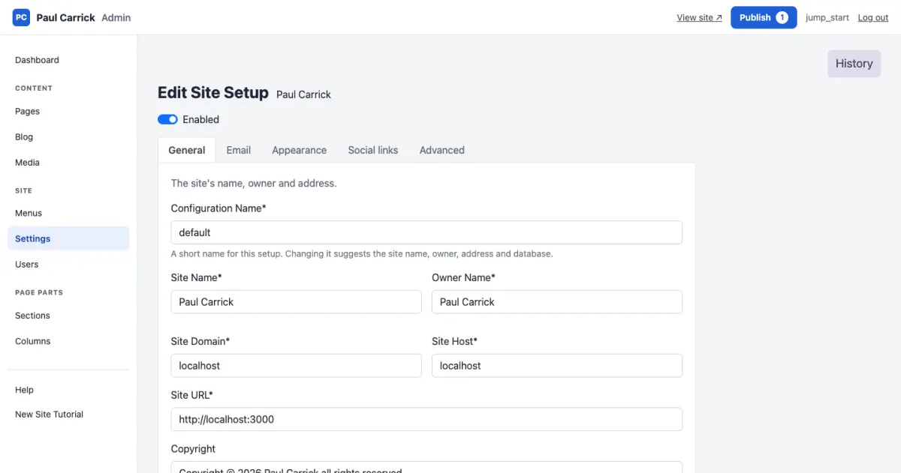
3. On the **Appearance** tab, choose the header, page and footer colors; the small preview shows how they look together.

    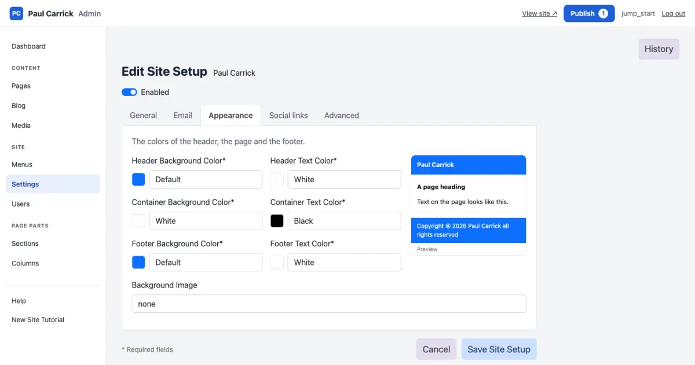
4. On the **Email** tab, review the mail server and contact addresses. After saving, **Send a test email** tells you whether they work. Leave optional integrations disabled until you have their actual credentials.

    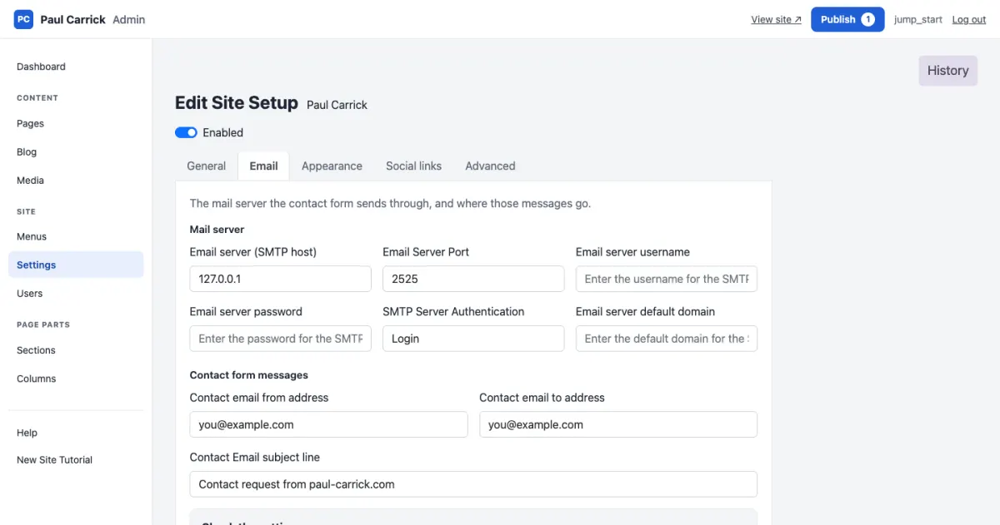
5. On the **Advanced** tab, keep the existing database value: changing that field does not rename the running database.
6. Choose **Save Site Setup**. Saving creates a draft. Choose **Publish** in the top bar, check the Settings group and publish it. Confirm the website still opens and displays the new site name.

    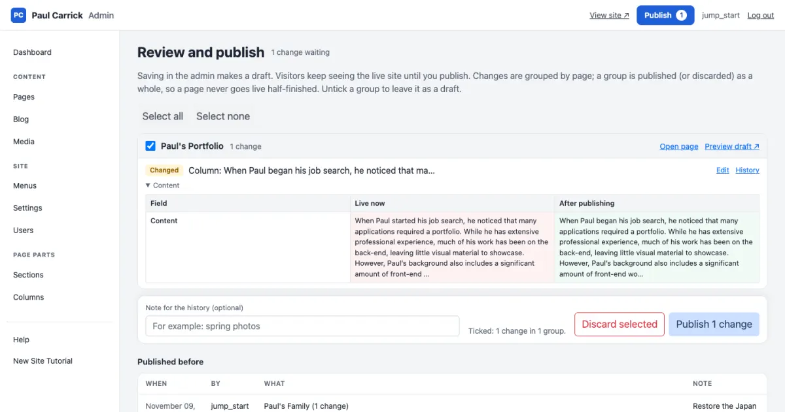

If you intend to add another independently routed website to an existing installation, use **New Site Setup** instead, give it a unique database name and URL, and follow the separate site-database provisioning procedure. That is different from adding pages to this first website.

## Edit the home page

1. Open **Pages** and click the starter home page's title. It opens in the page workspace: the outline on the left, the preview in the middle and the panel on the right.

    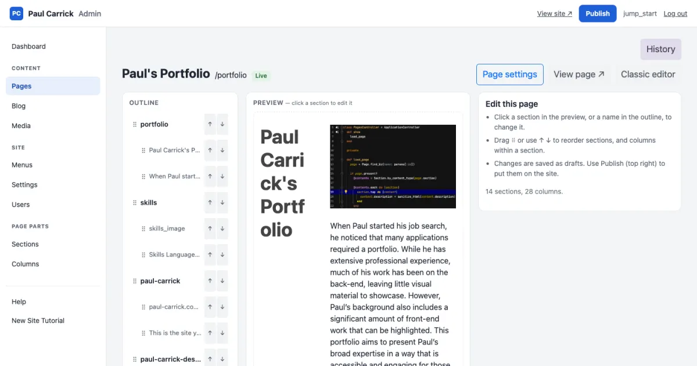
2. Choose **Page settings**, change the title to **Welcome to Willow Studio**, and save. Keep its Page Name and Section field so the home address continues to find its content.

    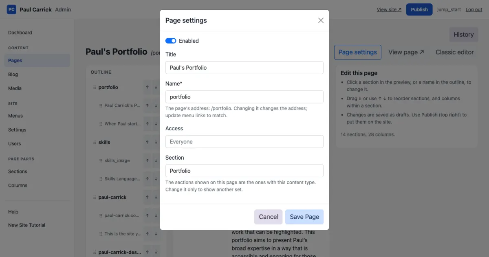
3. Click the welcome section in the preview, or choose **+ Add section** under the outline and pick the **Text Only** layout for an introduction.
4. In the outline, click the text column. In the panel's **Content** tab enter: "Welcome to Willow Studio. We create thoughtful spaces for everyday living." Use the toolbar for headings, paragraphs and emphasis; you do not need to write HTML.

    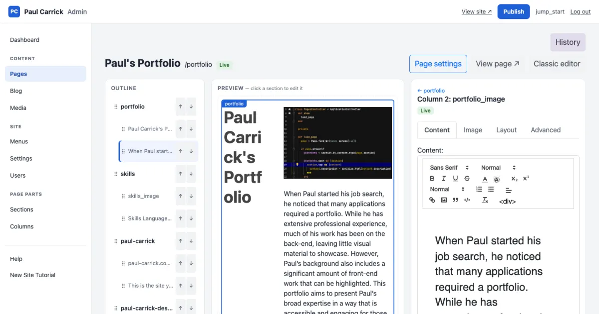
5. Choose **Save Column**. The preview shows the change. Use **↑** and **↓** in the outline to put the section where you want it.
6. Changes remain drafts until published; the public site still shows the previous version.

## Add your first image

1. Open **Media** and drop a photograph on the upload area (or choose **choose files**), then **Upload**. It is named after its file, for example `willow-studio-welcome`. Use a reasonably sized web image rather than an unnecessarily large original. Click its thumbnail to add a caption with **Edit caption, description or file**.

    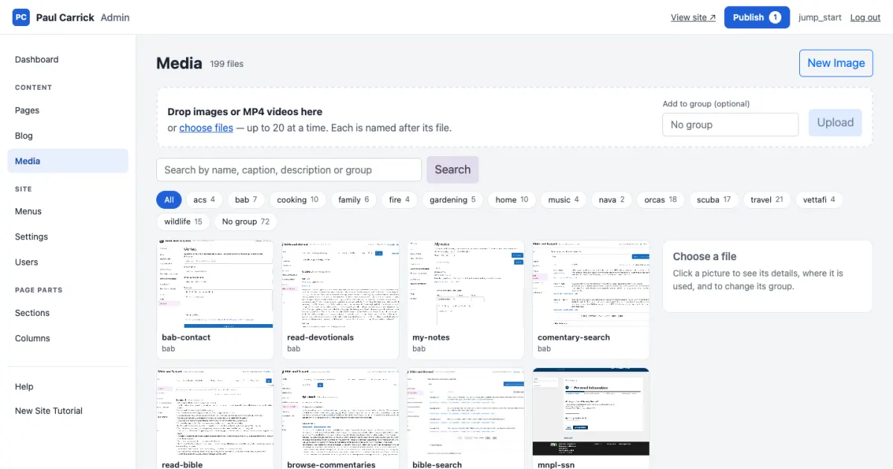

    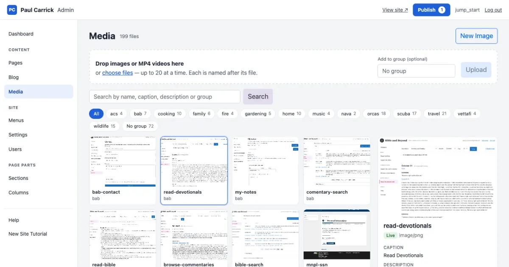
2. Return to the home page's workspace. Add a section with an image and text layout, or click an existing image column.
3. In the panel's **Image** tab, select the uploaded image (or use **New Image** to upload one without leaving the page). In the **Content** tab enter accompanying text such as "Explore our recent projects." Choose **Save Column** and check the image's fit in the preview.

    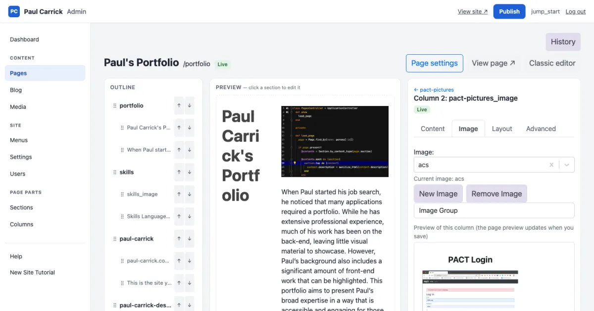
4. Choose **Publish**, check the home page's group and publish it, then open the home page to check the result. Back in **Media**, the image's details now list the home page under **Used on**.

## Create an About page with text and images

1. Open **Pages**, then **New page**.
2. Enter Page Title **About Willow Studio**, a unique Page Name such as `about`, and a unique Section such as `about-willow`. Set Access for public viewing and ensure the page is enabled. Save it.

    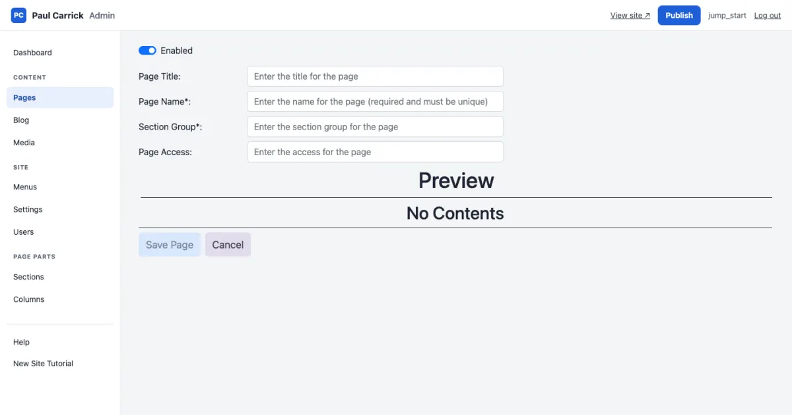
3. Open the new page from the Pages list and choose **+ Add section**.

    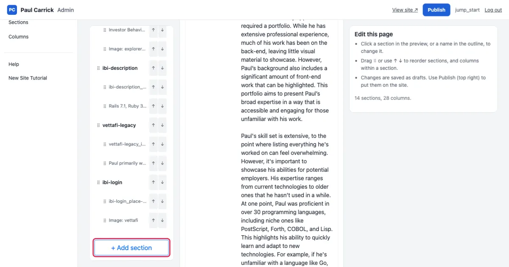
4. Choose a text and image layout, fill in what it asks for, choose **Generate Columns**, name the section **Our story**, and choose **Save Section**. You return to the workspace.

    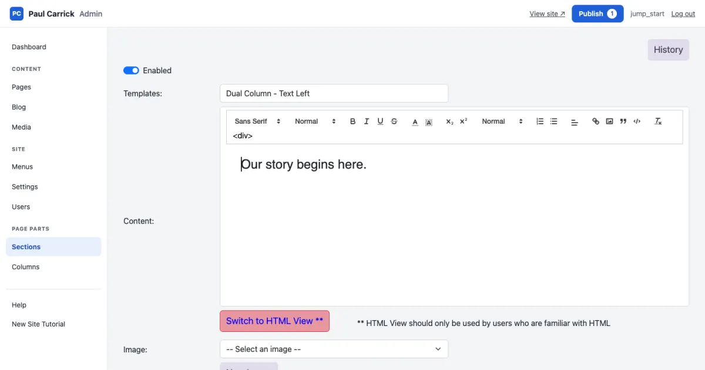

    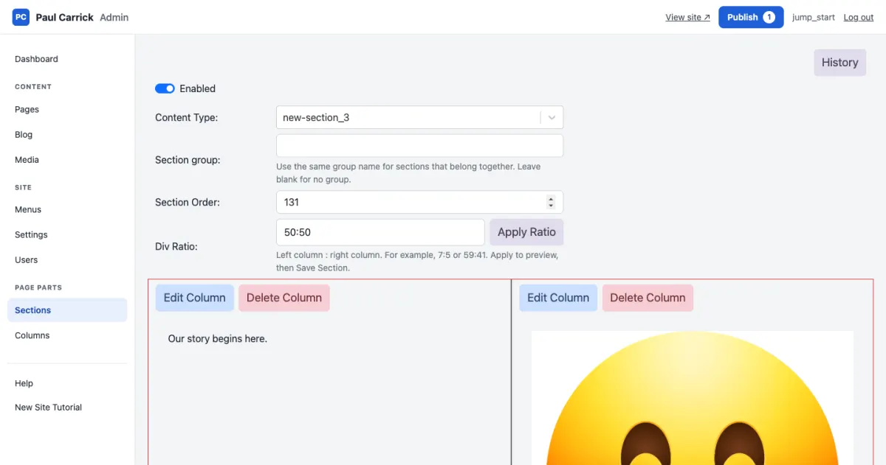
5. Click the text column and add a heading and two short paragraphs explaining who you are, what you offer, and whom you help. Save the column.
6. Click the image column and select an image in the **Image** tab. Save the column.
7. Add another Text Only section called **What we do** if you want more content. Use a list for your services.

## Add the page to navigation

1. Open **Menus**. With **Header menu** chosen, choose **Add an item**.

    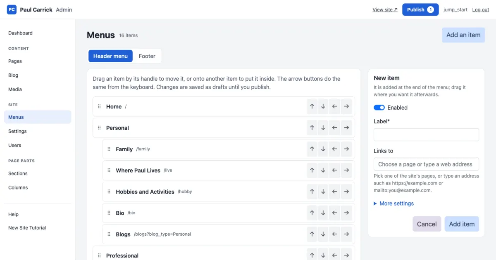
2. Set the Label to **About**. In **Links to**, choose `/about` from the list of the site's pages (the page's name, not its title). Choose **Add item**.
3. The item is added at the end. Drag its **⠿** handle, or use the arrow buttons, to put it where you want it; **→** puts it inside the item above, as a dropdown entry.

    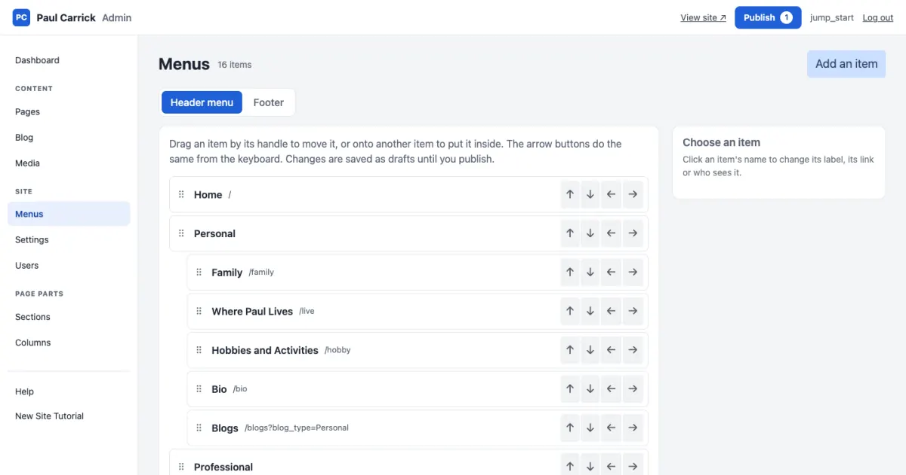
4. Choose **Publish**. The About page's group holds its page, sections and columns; the Header menu group holds the new item. Tick both, read the list, and publish. Read any reported errors before proceeding.
5. Open the public website and click **About**. Check that it opens the intended page and that the text and images appear. Repeat these steps for Services, Projects, or another page.

## Edit a page while looking at it

You can also change a page while viewing it on the site.

1. Open the page on the site, scroll to the bottom and choose **Edit Page**.
2. Right-click a picture, a column's text or the space around a section and choose **Edit**. The matching editor opens in a new tab; save your change there and come back.
3. To move a section, point at it and use its **⠿ Move ↑ ↓** handle.
4. Choose **Save Changes** to publish what you changed, or **Cancel** to throw it away.

    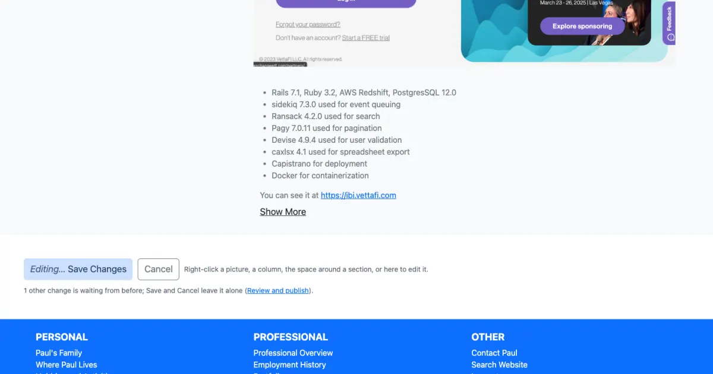

    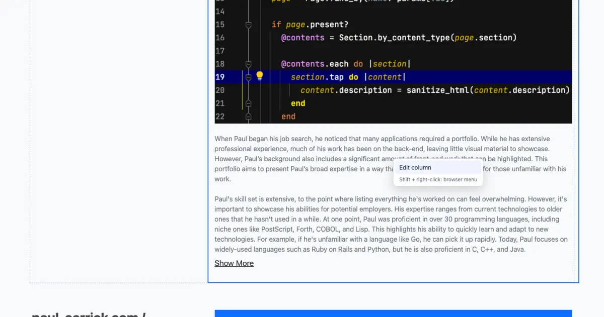

## Review before sharing

1. Check Home and every new page both signed in and signed out. Confirm public pages do not require an administrator login.
2. Narrow the browser to a phone-sized width. Check text wrapping, image cropping, button alignment, and the navigation menu.
3. Test links and review spelling, captions, and image descriptions. Confirm the new page is reachable from navigation.
4. Confirm only intended drafts were published: **Publish** in the top bar shows how many are still waiting. Saving and publishing are separate steps; cancelling an editor does not undo an earlier save.
5. Back up the database, uploaded files, and private configuration before upgrading or moving the site.
6. For public hosting, configure your domain, HTTPS, and forwarding first, then update Site URL and related settings to the real address. The container quick start is local HTTP by default. Do not replace an existing production deployment with it without a migration plan.

## If something does not appear

- **A new page is missing:** check Enabled, access, its navigation link on the Menus screen, and whether its group was published.
- **Text changes disappeared after closing an editor:** choose **Save Column** before selecting something else in the workspace.
- **An uploaded image is not shown:** select it in the column's Image tab, save the column, and publish. Uploading alone does not place an image on a page; the image's **Used on** list in Media shows where it is used.
- **The site stops matching the local address:** check Site URL and routing settings. Use the same address the setup is configured to serve.
- **Containers do not start:** run `docker compose ps` and `docker compose logs rails db`; keep the private configuration and volumes intact while investigating.
